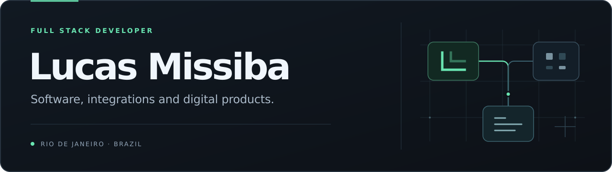

<a href="./README.md">Ler em português →</a>

## From business needs to software in operation.

I'm **Lucas Missiba**, a full stack developer based in **Rio de Janeiro, Brazil**. I build digital products, integrations and automations that address practical business needs.

My work connects software development, data and operations: from interfaces to APIs, and from internal workflows to the infrastructure that keeps a product running.

### What I build

- **Digital products** — web applications, CRMs, portals and management tools.
- **Integrations** — connections between APIs, ERP systems, platforms and services.
- **Automation and data** — workflows and dashboards that organize information and reduce manual work.

### Selected projects

<table>
<tr>
<td width="50%" valign="top">
<h3>Sentinel CRM</h3>

Sales and customer relationship management, with integrations and automation.

CRM · SALES · INTEGRATIONS

</td>
<td width="50%" valign="top">
<h3>PrestyBI</h3>

Commercial business intelligence and data visualization to support decisions.

BI · DATA · VISUALIZATION

</td>
</tr>
<tr>
<td width="50%" valign="top">
<h3>PrestyIT</h3>

Portals and internal tools that support business operations.

PORTALS · SYSTEMS · OPERATIONS

</td>
<td width="50%" valign="top">
<h3>Between</h3>

A platform focused on corporate psychology.

PLATFORM · PRODUCT · EXPERIENCE

</td>
</tr>
</table>

A selection of professional projects. Their source code is private.

### Technologies and tools

| Area | Technologies and tools |
| :--- | :--- |
| Development | **TypeScript** · **Next.js** · **Python** |
| Data | **PostgreSQL** · **MySQL** · **Prisma** · **SQL** |
| Integration and operations | **REST APIs** · **Git** · **Linux** |

### How I work

Understand the process, build a clear solution and follow how it is used. I'm particularly interested in integrations, information security and the connection between technology and business management.

---

Lucas Missiba · Rio de Janeiro, Brazil · <a href="https://github.com/lucasmissibadev">@lucasmissibadev</a>

