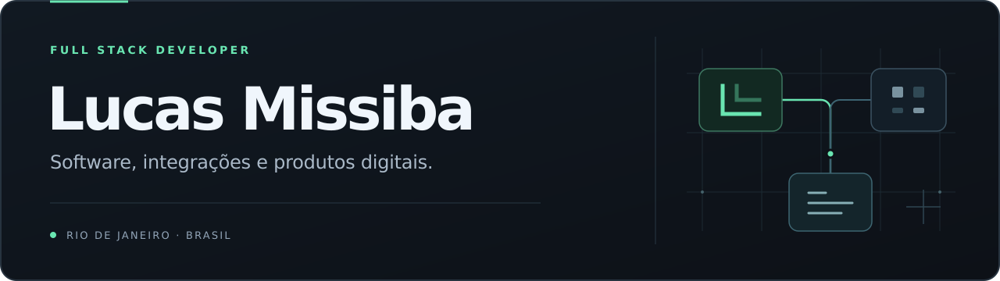

<a href="./README.en.md">Read in English →</a>

## Do problema de negócio ao software em operação.

Sou **Lucas Missiba**, desenvolvedor full stack no **Rio de Janeiro**. Trabalho na construção de produtos digitais, integrações e automações para resolver necessidades reais de negócio.

Minha atuação conecta desenvolvimento, dados e operação: da interface às APIs, dos processos internos à infraestrutura que mantém o produto funcionando.

### O que eu construo

- **Produtos digitais** — aplicações web, CRMs, portais e ferramentas de gestão.
- **Integrações** — conexões entre APIs, ERPs, plataformas e serviços.
- **Automações e dados** — rotinas e painéis para organizar informações e reduzir trabalho manual.

### Projetos selecionados

<table>
<tr>
<td width="50%" valign="top">
<h3>Sentinel CRM</h3>

Gestão comercial e relacionamento com clientes, com integrações e automações.

CRM · COMERCIAL · INTEGRAÇÕES

</td>
<td width="50%" valign="top">
<h3>PrestyBI</h3>

BI comercial e visualização de informações para apoiar decisões.

BI · DADOS · VISUALIZAÇÃO

</td>
</tr>
<tr>
<td width="50%" valign="top">
<h3>PrestyIT</h3>

Portais e soluções internas para apoiar a operação.

PORTAIS · SISTEMAS · OPERAÇÃO

</td>
<td width="50%" valign="top">
<h3>Between</h3>

Plataforma voltada à psicologia corporativa.

PLATAFORMA · PRODUTO · EXPERIÊNCIA

</td>
</tr>
</table>

Seleção de projetos profissionais. Os respectivos códigos-fonte são privados.

### Tecnologias e ferramentas

| Área | Tecnologias e ferramentas |
| :--- | :--- |
| Desenvolvimento | **TypeScript** · **Next.js** · **Python** |
| Dados | **PostgreSQL** · **MySQL** · **Prisma** · **SQL** |
| Integração e operação | **APIs REST** · **Git** · **Linux** |

### Como eu trabalho

Entender o processo, construir uma solução clara e acompanhar seu uso. Tenho interesse especial em integrações, segurança da informação e na relação entre tecnologia e gestão.

---

Lucas Missiba · Rio de Janeiro, Brasil · <a href="https://github.com/lucasmissibadev">@lucasmissibadev</a>

